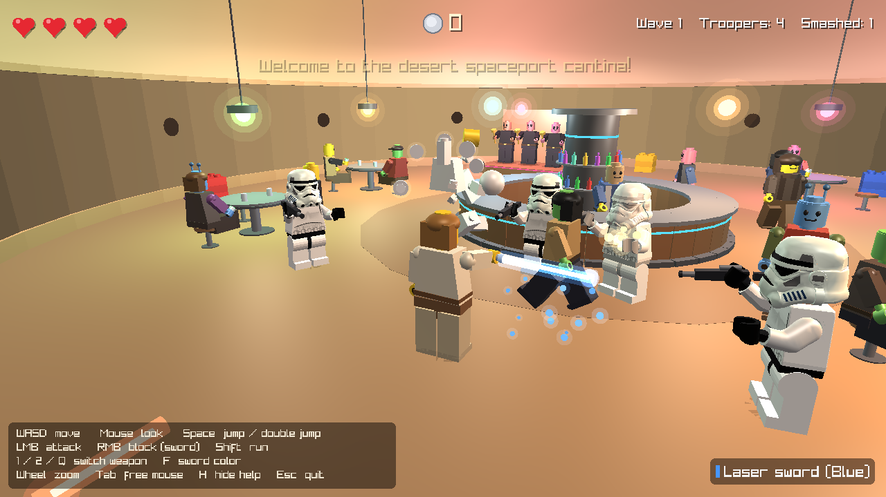

# Brick Wars: Cantina Brawl (`lego-game`)

A small third-person brick-toy action game written in C++ with [raylib](https://www.raylib.com/).
It is a fan-style homage **inspired by** the LEGO® Star Wars™ video games: blocky minifigures,
laser swords, blasters, a domed desert spaceport cantina, and enemies that shatter into bricks and
studs you can collect.



> **Not affiliated.** This project is not affiliated with, endorsed by, or connected to the LEGO Group,
> Lucasfilm or Disney. It contains no official LEGO or Lucasfilm assets. The level, the player and the other
> characters, props and weapons are generated procedurally in code from cubes, cylinders and spheres, and all
> sound effects are synthesized at runtime. The only external asset is a fan-made trooper model licensed
> under CC BY 4.0 (see [Credits](#credits)).

## Features

- **Third-person camera** that orbits with the mouse, zooms with the wheel and avoids clipping into walls.
- **Procedural cantina**: sandy domed room with doorway, round central bar with a drinks tower, round tables
  and stools, a band stage, colored hanging lamps, plus desert huts, dunes and twin suns outside.
- **Brick-toy minifigures**: cylinder head with stud, trapezoid torso, blocky arms with C-shaped hands,
  hips and legs, walk cycle with swinging arms and legs. Alien patrons, a band and a bartender.
- **Armored white troopers** use a CC BY 4.0 fan model (`assets/models/trooper.glb`) loaded with raylib.
  Its legs, arms and hands are separate meshes, so the game animates walking and aiming by rotating them.
  If the file is missing (or with `--no-model`) the game falls back to procedural troopers.
- **Laser sword**: ignition animation, glowing blade in 5 colors, three-hit swing combo, blocking that
  **deflects enemy bolts** back at the troopers.
- **Blaster**: shoots glowing bolts with light auto-aim.
- **Smash everything**: hit minifigures and brick crates break apart into physically bouncing bricks and
  spill **studs** (silver 10, gold 100, blue 1000) that get magnetically pulled to you.
- **Waves** of troopers storm in through the doorway, take cover-less potshots and get smashed.
- **HUD**: hearts (with regeneration), stud counter, wave info, weapon panel and a controls hint.
- Procedural sound effects (blaster, sword swing, brick clatter, stud pickup...).

## Controls

| Input | Action |
| --- | --- |
| `W A S D` / arrow keys | Move (relative to the camera) |
| Mouse | Rotate the camera |
| Mouse wheel | Zoom |
| `Space` | Jump (press again in the air for a double jump) |
| Left mouse button | Attack (sword swing / fire blaster) |
| Right mouse button | Block with the laser sword (deflects bolts) |
| `Left Shift` | Run |
| `1` / `2` / `Q` | Laser sword / blaster / toggle |
| `F` | Change laser sword color |
| `Tab` | Release / capture the mouse |
| `H` | Toggle the controls hint |
| `Esc` | Quit |

## Building

You only need **a C++17 compiler, CMake ≥ 3.16** and an internet connection for the first build.
CMake downloads the pinned **raylib 5.5** source tarball once (about 40 MB, kept inside `build/`; no git
history, raylib examples and games are not built) and compiles it together with the game. Nothing is
installed system-wide. If a raylib 5.5 package is already installed, CMake uses that instead.

The commands are the same on every platform:

```sh
cmake -B build -DCMAKE_BUILD_TYPE=Release
cmake --build build --config Release
```

The executable ends up in `build/bin/` (`build/bin/lego-game` or `build\bin\lego-game.exe`).
Alternatively run `./build.sh run` (Linux/macOS) or `build.bat run` (Windows) to build and start in one go.

### Linux

Debian / Ubuntu (compiler, CMake and the X11/OpenGL headers that raylib needs):

```sh
sudo apt install build-essential cmake libx11-dev libxrandr-dev libxinerama-dev libxcursor-dev libxi-dev libgl1-mesa-dev
```

Fedora: `sudo dnf install gcc-c++ cmake libX11-devel libXrandr-devel libXinerama-devel libXcursor-devel libXi-devel mesa-libGL-devel`
Arch: `sudo pacman -S base-devel cmake libx11 libxrandr libxinerama libxcursor libxi mesa`

```sh
cmake -B build -DCMAKE_BUILD_TYPE=Release
cmake --build build --config Release -j
./build/bin/lego-game
```

(Wayland sessions run the game through XWayland.)

### macOS

```sh
xcode-select --install      # Apple clang
brew install cmake          # or download CMake from cmake.org
cmake -B build -DCMAKE_BUILD_TYPE=Release
cmake --build build --config Release -j
./build/bin/lego-game
```

### Windows (MSVC)

Install the **Visual Studio 2022 Build Tools** (workload "Desktop development with C++"; it includes CMake).
Open a *Developer PowerShell for VS 2022* and run:

```bat
cmake -B build -DCMAKE_BUILD_TYPE=Release
cmake --build build --config Release
build\bin\lego-game.exe
```

### Windows (MinGW-w64)

With MinGW-w64 (e.g. from [w64devkit](https://github.com/skeeto/w64devkit) or MSYS2) and CMake on your `PATH`:

```bat
cmake -B build -G "MinGW Makefiles" -DCMAKE_BUILD_TYPE=Release
cmake --build build --config Release
build\bin\lego-game.exe
```

### Command line options

```
lego-game [--width N] [--height N] [--screenshot FILE [--frames N]] [--no-model]
```

The game looks for `assets/models/trooper.glb` next to the executable (CMake copies `assets/` into
`build/bin/` after every build), then in `../../assets` relative to the executable, then in the working directory,
so it works when started from the repository root or from `build/bin`.

`--screenshot` runs a short scripted scene, saves a PNG and exits (used by CI as a headless smoke test,
e.g. `xvfb-run -a ./build/bin/lego-game --screenshot shot.png`).

## Code layout

| File | Purpose |
| --- | --- |
| `src/main.cpp` | Command line parsing, entry point |
| `src/game.cpp` | Game loop, player, camera, enemy AI, waves, bolts, HUD |
| `src/minifig.cpp` | Procedural minifigure model, poses, and breaking it into bricks |
| `src/weapons.cpp` | Laser sword, blaster, bolts and small props |
| `src/level.cpp` | Cantina geometry, lamps and collision queries |
| `src/effects.cpp` | Brick debris physics, collectible studs, sparks |
| `src/render.cpp` | Lit primitive renderer (embedded GLSL shader, glow halos, blob shadows) |
| `src/audio.cpp` | Runtime-synthesized sound effects |
| `src/trooper_model.cpp` | Loads `assets/models/trooper.glb`, normalizes it, animates its limb meshes |

## Credits

- **"Lego Stormtrooper"** 3D model by [ThrillDaWill](https://sketchfab.com/ThrillDaWill)
  ([Sketchfab](https://sketchfab.com/3d-models/lego-stormtrooper-e4581317a2844d09ae7252abb73c63d2)),
  licensed under [CC BY 4.0](https://creativecommons.org/licenses/by/4.0/). It is included unmodified in
  `assets/models/trooper.glb`; the game only scales, positions and animates it at runtime. It is a fan model;
  neither its author nor this project is affiliated with the LEGO Group or Lucasfilm.
- [raylib](https://www.raylib.com/) by Ramon Santamaria and contributors (zlib/libpng license).

See [CREDITS.md](CREDITS.md) for details.

## License

MIT for the code in this repository. The trooper model in `assets/models/` is licensed separately under
CC BY 4.0 (see `assets/models/LICENSE.txt`). raylib is licensed under the zlib/libpng license.
LEGO and Star Wars are trademarks of their respective owners and are mentioned only to describe the inspiration
and to credit the fan model.
